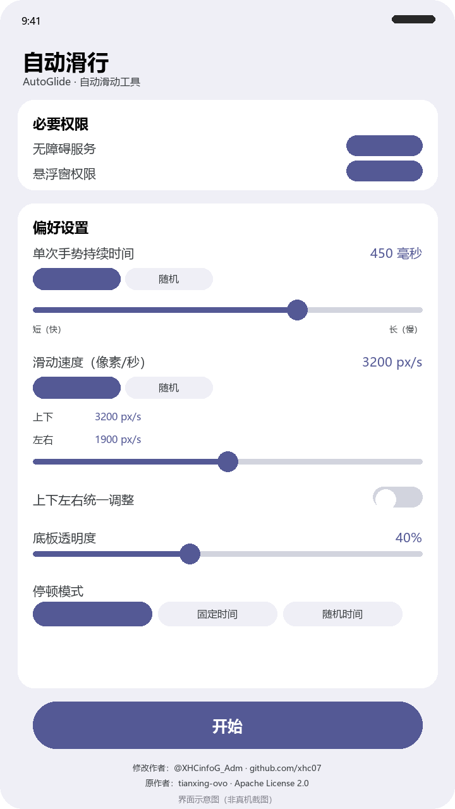

# AutoGlide 自动滑行


[](LICENSE)


AutoGlide（自动滑行）是一个基于 [AutoSlide](https://github.com/tianxing-ovo/AutoSlide) 修改的 Android 自动滑动工具，适用于自动化测试、内容浏览和需要周期性滑动的场景。

> 下图是界面示意图，不是真机截图。



## 功能

- **滑动方向**：向上、向下、向左、向右四个方向。
- **单次手势持续时间**：支持固定值和随机范围，直接控制一次手势从起点到终点的时长。
- **像素速度**：以 `px/s` 控制滑动速度，上下方向和左右方向可分别设置；支持“上下左右统一调整”。
- **固定 / 随机**：持续时间和像素速度都可以选择固定模式或随机模式，随机模式下可设置最小值和最大值。
- **停顿模式**：不停顿、固定时间、随机时间三种模式。
- **自定义数值**：所有滑块设置都可以点击数值直接输入精确值。
- **自定义轨迹**：长按方向按钮录制该方向的滑动路径，自动滑动时回放。
- **悬浮窗控制**：悬浮球启停、方向按钮、底板透明度调节。
- **通知栏磁贴**：通过系统快捷设置开关悬浮窗服务。
- **安全停止**：音量键强制停止、息屏自动停止。
- **权限开启**：支持手动、Shizuku、ADB 三种方式开启无障碍服务。
- **页面滚动**：设置页支持上下滚动，大字体或高显示比例下不会截断选项。

## 与原版的主要差异

1. 将原来的 1–100“滑动速度”改为“单次手势持续时间（毫秒）”。
2. 新增“像素速度（px/s）”设置，支持上下/左右分别调整和统一调整。
3. 持续时间和像素速度均支持固定/随机模式，随机模式下可设置范围。
4. 所有滑块都增加自定义数值输入。
5. 设置页增加纵向滚动。
6. 删除应用内“检查更新”功能，移除网络与安装 APK 相关权限。
7. 更换应用图标、应用名称、包名，并提升版本号。
8. 在应用内和本 README 中标注修改作者与原作者信息。

## 安装

- Android 8.0（API 26）及以上。
- 包名：`com.xhc07.autoglide`
- 版本：`1.0.0`（versionCode `23`）
- 与原版 AutoSlide 包名不同，可以同时安装，不会覆盖原版。

从源码构建：

```bash
./gradlew assembleRelease
```

生成文件位于：

```text
app/build/outputs/apk/release/AutoGlide-v1.0.0.apk
```

构建环境要求：JDK 21、Android SDK Platform 37（`compileSdkMinor = 0`）、Build Tools 37.0.0、Gradle 8.14.6。

## 修改作者

- 修改作者：[@XHCinfoG_Adm](https://github.com/xhc07)
- GitHub：<https://github.com/xhc07>
- 仓库：<https://github.com/xhc07/AutoGlide>

## 原作者与来源

- 原项目：[tianxing-ovo/AutoSlide](https://github.com/tianxing-ovo/AutoSlide)
- 原作者：tianxing-ovo
- 原项目 GitHub：<https://github.com/tianxing-ovo>

本项目是在原项目源码基础上的修改版，与原作者无隶属关系，原作者未对本修改版作出背书。

## 许可证

本项目沿用原项目的 **Apache License 2.0**，详见 [LICENSE](LICENSE) 与 [NOTICE](NOTICE)。

根据 Apache License 2.0：

- 保留原始版权声明和许可证文本；
- 修改过的文件已在源码中标注修改说明；
- 不以原作者名义为修改版背书；
- 原项目名称 `AutoSlide` 仅用于说明来源。

## 免责声明

本项目仅供自动化测试、辅助操作等合法用途使用。使用者应遵守目标应用的服务条款和当地法律法规，因使用本项目产生的一切后果由使用者自行承担。
